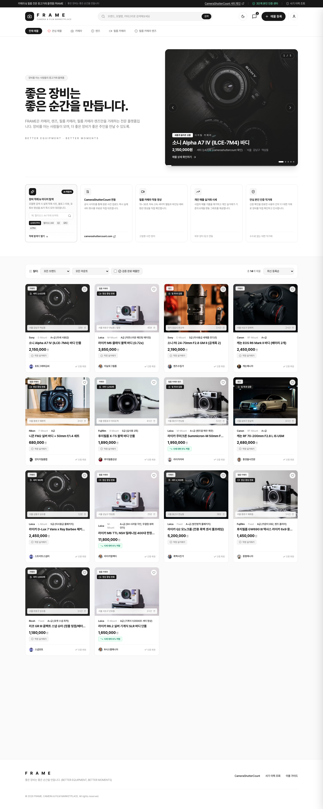
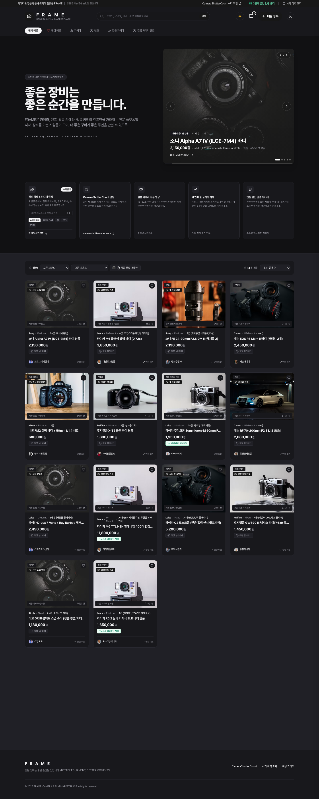

# FRAME

카메라 · 렌즈 · 필름 장비만 거래하는 카메라 전문 중고거래 플랫폼

🔗 **라이브 데모**: https://inseok5971.github.io/frame/




## 만든 이유

영상을 전공하며 고가의 카메라와 렌즈를 수없이 사고팔았습니다. 그때마다 판매자의 주관적인 상태 설명, 업자들의 시세 왜곡, 사기 불안감에 지쳤고, "장비를 제대로 아는 사람들을 위한 안심 플랫폼을 직접 만들자"는 생각으로 시작했습니다.

기획, UI/UX, 프론트엔드와 Supabase 연동까지 1인으로 0부터 만들었습니다.

---

## 핵심 기능

> **상태 표기**  
> ✅ 구현: 데모에서 동작 · 🎭 시연: UI와 흐름은 구현했고 결과는 Mock · 🔜 예정

| 기능 | 상태 | 설명 |
| --- | :---: | --- |
| 회원 인증 및 매물 클라우드 DB 연동 | ✅ 구현 | Supabase Auth 및 PostgreSQL RLS 기반 데이터 영구 저장 |
| 거래 상태 관리 시스템 | ✅ 구현 | 판매중 / 예약중 / 거래완료 3단계 실시간 제어 및 문의 차단 |
| 마이페이지 & 개인화 활동 허브 | ✅ 구현 | 내 매물 관리, 찜 목록, PASS 인증 정보를 관리하는 서랍형 UI |
| 관심 목록 (Wishlist / 찜) | ✅ 구현 | 헤더 실시간 뱃지, 모달 동기화, 찜 목록 즉시 1:1 채팅 연동 |
| 필름 카메라 · 렌즈 상태 증빙 등록 | ✅ 구현 | 셔터 구동 영상 2종 및 렌즈 조리개 투과 사진 3장 필수 첨부 |
| 카메라 전문 버티컬 구조 | ✅ 구현 | 바디·렌즈 전용 스펙, 마운트/셔터수 필터링, 다크/라이트 테마 |
| 1:1 직거래 안심 채팅 | ✅ 구현 | 매물 연동 실시간 대화방 및 안전 직거래 가이드라인 제공 |
| 단계별 고객센터 & 1:1 문의 접수 | ✅ 구현 | 문제 유형별 3단계 문의 플로우 및 사진 증빙 업로드 접수 |
| 작례 탐색 | ✅ 구현 | Flickr, YouTube, 블로그 실제 결과물 모아보기 (`server.py` 로컬 실행 시) |
| 2단계 실명 본인 인증 구조 | 🎭 시연 | 불필요한 신분증 사본 제거, PASS 통신사 실명확인 중심 설계 |
| 개인 매물 기준 시세 분석 | 🎭 시연 | Chart.js 기반 시세 추이 및 적정 실거래가 자동 판정 뱃지 |
| 디지털 카메라 셔터 횟수 확인 | 🎭 시연 | CameraShutterCount 사이트 교차 검증 흐름 구현 |

---

### 1. 거래 상태 관리 시스템 (`판매중` / `예약중` / `거래완료`) ✅
C2C 중고거래의 핵심인 매물 상태 추적 및 헛걸음 방지 파이프라인을 구축했습니다.
- **실시간 상태 동기화**: `localStorage` 기반 상태 관리로 브라우저를 새로고침하거나 재접속해도 매물 상태가 영구 보존됩니다.
- **직관적인 피드 시각 효과**:
  - `거래완료`: 썸네일에 다크 딤드 오버레이와 **"거래 완료"** 뱃지가 적용되며 가격 취소선 처리
  - `예약중`: 썸네일 상단에 앰버 컬러의 **"예약중"** 뱃지가 실시간 표시
- **소유자 전용 제어 패널**: 상세 모달 및 마이페이지에서 판매자 본인에게만 상태 변경 토글 버튼(`판매중` / `예약중` / `거래완료`)이 노출되어 원클릭으로 상태를 전환할 수 있습니다.
- **불필요한 문의 원천 차단**: 거래가 완료된 매물은 상세 모달의 `1:1 직거래 문의하기` 버튼이 즉시 비활성화되며 *"거래가 완료된 매물입니다"* 안내 문구로 전환됩니다.

### 2. 마이페이지 & 개인화 활동 허브 (슬라이드아웃 서랍) ✅
상단 헤더 우측의 `마이페이지` 버튼 또는 사용자 프로필 클릭 시 부드럽게 열리는 일체형 활동 센터입니다.
- **3대 활동 지표 카운터**: 등록 매물 수, 찜한 관심 매물 수, PASS 본인인증 등급을 상단에 한눈에 노출하며 클릭 시 해당 탭으로 즉시 전환됩니다.
- **내 매물 관리 (Tab 1)**: 본인이 등록한 장비 목록을 확인하고, 거래 상태 세그먼트 버튼을 통해 실시간으로 상태를 변경하거나 매물을 삭제할 수 있습니다. (데모 체험을 위해 기본 샘플 매물이 배정되어 바로 테스트 가능)
- **관심 목록 (Tab 2)**: 찜해둔 장비들의 최신 거래 상태를 실시간 확인하고, `1:1 문의` 버튼으로 해당 판매자와 즉시 채팅을 시작할 수 있습니다.
- **인증 정보 (Tab 3)**: KCB 및 통신 3사 연동 PASS 실명확인 상세(마스킹된 실명/연락처, 통신사, SHA-256 CI/DI 암호화 코드) 확인 및 인증 갱신을 지원합니다.

### 3. 관심 목록 (Wishlist / 찜) 고도화 ✅
- **상단 헤더 실시간 뱃지**: 상단 헤더의 하트 아이콘에 현재 찜한 매물 수가 실시간 뱃지(`0건` 초과 시 레드 뱃지)로 표시되며, 클릭 시 마이페이지 찜 목록으로 바로 이동합니다.
- **양방향 실시간 동기화**: 메인 피드 카드의 하트 버튼, 상세 모달 내 북마크 버튼, 마이페이지 찜 탭이 유기적으로 실시간 동기화됩니다.

### 4. 회원 인증 및 매물 클라우드 DB 연동 ✅
Supabase(PostgreSQL)를 연동하여 실제 회원가입, 로그인 세션 관리, 매물 등록 데이터의 영구 저장을 구현했습니다.
- **인증(Auth)**: 이메일/비밀번호 기반 회원가입 및 세션 관리, 마스터 관리자(admin) 권한 체계 구축 (DB의 role 값과 RLS로 서버에서 검증)
- **데이터베이스(DB)**: 등록한 카메라 및 렌즈 매물이 클라우드 DB에 실시간 저장되어 새로고침 및 다른 기기 접속 시에도 영구 보존
- **보안(RLS)**: Row Level Security 정책을 적용하여 데이터 조회 및 등록 권한 분리 제어

### 5. 필름 카메라 · 렌즈 상태 증빙 ✅
필름 카메라와 올드 렌즈는 디지털처럼 상태를 숫자로 읽을 수 없고 사진은 쉽게 속일 수 있어, 등록 시 증빙을 필수로 받습니다.
- **필름 카메라**: 1초 저속 셔터(늘어짐 검증)와 1/1000초 고속 셔터(찢어짐 검증) 구동 영상 각 1개 필수 첨부
- **렌즈**: 앞면·뒷면·조리개 개방 투과 사진 3장 필수 첨부 (곰팡이·먼지·빛 투과율 확인용)

증빙은 판매자가 제출한 실제 자료이며, 구매자가 상세 모달에서 직접 영상을 재생하고 관통 사진을 확대하여 자가 검증할 수 있도록 뷰어를 제공합니다.

### 6. 카메라 전문 버티컬 구조 & 모바일 최적화 ✅
카메라, 렌즈, 필름 카메라, 필름 카메라 렌즈만 전문적으로 다룹니다. 품목이 한정되어 있어 카테고리별로 필요한 정보(브랜드, 마운트, 셔터 횟수, 작동 상태 등)를 구조화해서 입력받고, 브랜드·마운트 필터와 "검증 완료 매물만" 보기로 같은 조건의 매물을 비교할 수 있습니다.
- **모바일 데스크톱 뷰포트 최적화**: 모바일 접속 시에도 정보 밀도 높은 데스크톱 그리드와 차트 레이아웃이 왜곡 없이 온전히 렌더링되도록 1280px 최소 뷰포트를 고정하고 부드러운 핀치 줌을 지원합니다.

### 7. 단계별 고객센터 & 1:1 사진 증빙 접수 시스템 ✅
거래 분쟁, 허위 매물, 계정 문의 등을 빠르고 체계적으로 접수할 수 있도록 직관적인 3단계 고객센터 플로우를 구축했습니다.
- **1단계 (홈/FAQ)**: 직거래 사기 예방 수칙, 셔터수 확인법 등 카테고리별 핵심 가이드 제공
- **2단계 (유형 선택)**: 허위 매물 신고, 거래 분쟁, 본인인증 오류 등 접수 사유 분류
- **3단계 (작성 및 증빙 첨부)**: 문의 내용 작성과 함께 현장 사진/캡처 증빙을 첨부하여 접수

### 8. 간결하고 안전한 2단계 본인 인증 구조 🎭
카메라 중고 거래의 특성상 사기 불안을 차단하는 것이 가장 중요하지만, 지나치게 복잡한 절차(신분증 사본 업로드 등)는 사용자의 심리적 거부감과 이탈률을 높입니다.  
FRAME은 당근마켓·번개장터 등 국내 1군 C2C 플랫폼의 UX 표준을 준수하여 **실명 휴대폰 인증 중심의 간결한 2단계 구조**로 설계했습니다.
- **Lv.1 (기본 가입)**: 이메일 간편 가입으로 매물 탐색 및 1:1 직거래 문의 가능 (진입 장벽 최소화)
- **Lv.2 (PASS 휴대폰 실명 확인)**: 방송통신위원회 지정 본인확인기관(KCB) 통신사 본인확인 및 암호화 DI(중복가입확인정보) 발급을 거쳐 매물 등록 권한 획득 (대포폰/중복 사기 계정 원천 차단)

불필요한 민감 정보(주민등록증 사본 등) 수집에 따른 법적 리스크와 사용자 피로도를 제거하고, `VerificationProvider` 인터페이스 패턴으로 외부 PG사(토스 본인인증 등) 연동 시 설정값만으로 즉시 상용 전환될 수 있도록 모듈화했습니다.

### 9. 작례 탐색 ✅
구매 전에 해당 바디와 렌즈로 찍은 실제 작례와 리뷰를 찾으려고 외부 사이트를 오가는 불편을 줄이기 위한 기능입니다. 모델명을 검색하면 Flickr, YouTube, 블로그 등의 작례와 리뷰를 모아 보여 줍니다.  
수집은 `server.py`로 동작하며, 로컬에서 서버를 실행해야 사용할 수 있습니다. GitHub Pages 데모에서는 외부 검색 링크로 대체됩니다.

### 10. 개인 매물 기준 시세 분석 & 셔터 횟수 🎭
- **시세 분석**: 사업자 매물을 제외한 개인 간 실거래가 기준으로 평균가, 최저/최고가, 시세 대비 가격 판단(저렴/적정/프리미엄) 및 Chart.js 시세 추이 그래프를 제공합니다.
- **디지털 카메라 셔터수 확인**: 판매자가 적는 임의 수치 대신 무보정 원본 사진 교차 검증을 위해 CameraShutterCount 연동 검증 흐름을 구현했습니다.

---

## 현재 상태와 개발 버전 히스토리

- **✅ v1.2 (최신 완료)**
  - 마이페이지 활동 서랍 (`#myPageDrawer`) 및 프로필 요약 구현
  - 매물 거래 상태 변경 (`판매중` / `예약중` / `거래완료`) 시스템 및 거래 완료 문의 차단
  - 관심 목록 (Wishlist / 찜) 헤더 뱃지 및 실시간 1:1 채팅 연동
  - 모바일 환경 1280px 데스크톱 스케일 뷰포트 최적화
- **✅ v1.1**
  - Supabase 연동 (PostgreSQL, Auth, Row Level Security 매물 클라우드 저장)
  - 2단계 간소화 본인인증 시스템 (신분증 사본 폐지 ➔ PASS 실명인증 혁신)
  - 단계별 고객센터 & 1:1 사진 증빙 문의 시스템 구축
- **✅ v1.0**
  - 화면 설계, 다크/라이트 테마, 카메라 전문 버티컬 구조, 영상/광학 증빙 등록, 1:1 직거래 안심 채팅
- **🔜 예정 로드맵**
  - 거래완료 후 매너 평가 및 거래 후기(별점/리뷰) 피드백 시스템
  - 1:1 채팅 내 외부 메신저 유도 및 피싱 의심 키워드 실시간 감지 알림
  - 실제 PG사(토스 본인인증) 라이브 API 연동 및 서버 메타데이터 자동 파싱

---

## 기술 스택

| 영역 | 기술 |
| --- | --- |
| 프론트엔드 | HTML5, Vanilla JavaScript (ES6+), Tailwind CSS |
| 백엔드 / DB | Supabase (PostgreSQL, Auth, Row Level Security) |
| 시각화 / UI | Chart.js, Lucide Icons |
| 작례 수집 | Python (`server.py`) |
| 배포 | GitHub Pages |

> **회원가입 안내**: 시연 편의를 위해 별도의 이메일 인증 없이 가입 즉시 로그인할 수 있습니다. 실서비스에서는 이메일 인증을 활성화할 예정입니다.

---

## 실행 방법

- **Supabase 설정 SQL**: `backend/schema.sql` (회원 자동 승인 트리거 및 1:1 문의 DB 스키마)

### 1. 기본 웹 데모 실행
```bash
# 1) 저장소 복제 및 디렉토리 이동
git clone https://github.com/inseok5971/frame.git
cd frame

# 2) 브라우저에서 바로 열기 (macOS)
open index.html

# 또는 로컬 웹 서버 실행 (권장)
python3 -m http.server 8000
# 브라우저에서 http://localhost:8000 접속
```

### 2. 작례 탐색 로컬 서버 실행 (`server.py`)
Flickr, YouTube, 블로그의 실시간 작례 및 리뷰 수집 기능을 로컬 환경에서 사용하려면 아래 명령어로 크롤러 서버를 함께 실행합니다.  
*(Python 3 표준 라이브러리만 사용하므로 별도의 `pip` 패키지 설치가 필요 없습니다.)*

```bash
# 별도의 터미널 창에서 실행 (기본 포트: 5050)
python3 server.py
```

---

## 피드백

장비를 사고팔아 본 경험에서 출발한 프로젝트입니다. 가감 없는 피드백은 [Issues](https://github.com/inseok5971/frame/issues)로 남겨 주세요.
