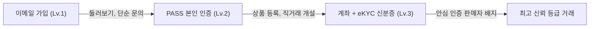
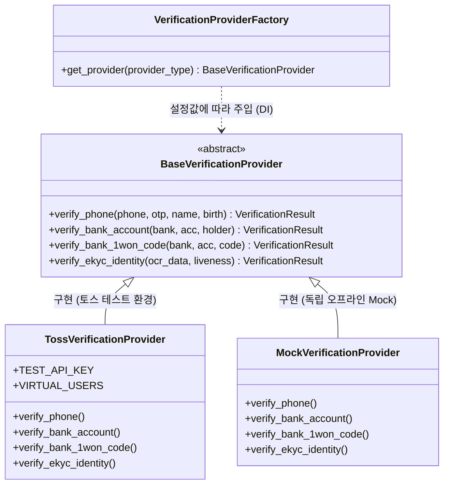

# 📷 FRAME | CAMERA & FILM MARKETPLACE

> **브랜드 슬로건**: "좋은 장비는 좋은 순간을 만듭니다." (BETTER EQUIPMENT · BETTER MOMENTS)  
> **서비스 비전**: "FRAME은 카메라, 렌즈, 필름 카메라, 필름 카메라 렌즈만을 거래하는 전문 중고거래 플랫폼입니다. 장비를 아는 사람들이 모여, 더 좋은 장비가 좋은 주인을 만날 수 있도록."

---

## 🎨 브랜드 가이드 & UI/UX 톤앤매너
* **Black (`#171717`)**: 메인 컬러 (로고, 텍스트, 주요 버튼, 브랜드 아이덴티티)
* **White (`#FFFFFF`)**: 배경, 카드, 기본 요소
* **Gray (`#8A8A8A` / `#737373`)**: 보조 컬러 (라벨, 보조 텍스트, 아이콘, 테두리)
* **심플 & 미니멀리즘**: 군더더기 없는 고급 카메라 매거진 감성의 UI와 신뢰 중심의 3단계 인증 시스템.

---

## 🔐 회원가입 및 3단계 본인 인증(eKYC/계좌) 아키텍처

기획서의 핵심 가치인 **"개인 간 편리함 + 사기 원천 차단"**을 위해 회원가입 정보를 3단계로 구조화하고, 법적 규제 준수를 위한 eKYC(전자 신원확인) 및 교체형 인터페이스 설계를 적용했습니다.

### 1. 회원가입 수집 정보 분류
| 구분 | 항목 | 수집/획득 방식 | 용도 및 법적 비고 |
|:---|:---|:---|:---|
| **직접 입력 (필수)** | 이메일 (로그인 ID) | 사용자 직접 입력 | 로그인 계정 식별 및 이메일 인증 발송 |
| | 비밀번호 | 사용자 직접 입력 | PBKDF2 단방향 해시 암호화 저장 |
| | 닉네임 | 사용자 직접 입력 | 거래 화면 노출용, 실시간 중복 확인 |
| | 필수 약관 동의 3종 | 체크박스 동의 | 이용약관, 개인정보 수집·이용, 만 14세 이상 확인 |
| **본인 인증 획득 (Lv.2)** | 이름, 생년월일, 성별, 전화번호 | PASS/통합인증 수신 | 실명 확인 및 직거래 연락망 확보 |
| | **CI (연계정보)** | PASS 수신 암호화값 | 개인 식별 불가 연계 식별값 |
| | **DI (중복가입확인정보)** | SHA-256 해시 저장 | **동일인 다중계정 및 사기 제재 후 재가입 방지** |
| **계좌/신분증 획득 (Lv.3)** | 은행명, 마스킹 계좌번호 | 1원 입금 / 실명 조회 | 판매자 대금 수령 계좌 및 자체 사기 DB 대조 |
| | eKYC 신분증 진위 & 셀피 | 신분증 OCR + 라이브니스 | 신분증 사진과 실시간 얼굴 대조 (사기 방지 극대화) |
| **직접 입력 (선택)** | 마케팅 수신 동의, 주 활동 지역, 소개 | 사용자 직접 입력 | 필수 동의와 엄격히 분리, 거래 신뢰도 보조 |

---

### 2. 단계별 가입 및 권한 흐름 (Verification Levels)



1. **레벨 1 (기본 가입 - 진입장벽 최소화)**
   * 이메일, 비밀번호, 닉네임, 필수 약관 동의로 가볍게 가입
   * 권한: 매물 탐색, 시세 조회, 단순 문의, 북마크
2. **레벨 2 (휴대폰 PASS 실명 인증 - 사기꾼 다중계정 차단)**
   * 통신사 PASS 본인 인증을 통한 CI / DI 발급
   * 권한: 상품 등록, 1:1 직거래 채팅 개설
3. **레벨 3 (계좌 인증 + eKYC 신분증/라이브니스 - 완전 신뢰 직거래)**
   * 본인 명의 계좌 1원 입금 또는 실명 일치 확인
   * 신분증 OCR + 실시간 셀피 라이브니스(눈 깜빡임/고개 돌림 감지) 교차 검증
   * 권한: **'안심 인증 판매자'** 공식 배지 부여, 매물 최상단 노출

---

### 3. 개인정보보호 및 법적 주의사항 준수
* ⚠️ **주민등록번호 절대 수집 금지**: 법적 근거 없는 주민등록번호 수집은 불법이므로, CI/DI 식별 체계로 전면 대체합니다.
* ⚠️ **신분증 사본 및 셀피 원본 비저장 원칙**: eKYC 솔루션 검증 통과 후 신분증 이미지 원본은 즉시 파기하며, DB에는 **"인증 일시, 인증 성공 여부, 제공자 트랜잭션 ID"** 메타데이터만 남깁니다.
* ⚠️ **계좌번호 마스킹 보관**: 계좌번호는 `110-***-123456` 형태로 마스킹하여 보관하고, 대조용 SHA-256 단방향 해시만 DB 인덱스로 활용합니다.

---

### 4. 구현 방식: 토스 인증 테스트 가이드 (Toss Sandbox) 및 아키텍처 분리

본 프로젝트는 포트폴리오 심사 및 기술 면접에서 가장 중요한 **"비즈니스 실무 연동 역량"**과 **"확장 가능한 객체지향 아키텍처"**를 증명하기 위해 **VerificationProvider 전략 패턴(Strategy Pattern)**과 **토스페이먼츠/토스 본인인증 테스트 환경**을 기반으로 설계되었습니다.

#### 💡 면접 핵심 답변 가이드 (Interview Key Point)
> **Q. 포트폴리오 프로젝트인데 본인인증과 계좌인증은 어떻게 구현했나요?**  
> **A.** "실제 본인인증(PASS/NICE) 및 계좌 실명조회 연동은 사업자등록 및 정식 PG/인증업체 계약이 필요합니다. 따라서 개발 단계에서는 **토스 본인인증(Toss Identity) 및 토스페이먼츠 1원 계좌인증 테스트 환경(가상 사용자 Sandbox)**을 기준으로 연동 규격을 완성하였으며, 내부 비즈니스 로직은 **`VerificationProvider` 전략 패턴(Strategy Pattern)**으로 인터페이스를 완전 분리했습니다. 이를 통해 향후 정식 계약 시 `settings.VERIFICATION_PROVIDER` 설정값 변경만으로 소스코드 수정 없이 즉시 상용 서비스로 전환(Dependency Injection)할 수 있도록 설계했습니다.  
> 또한 신분증 OCR 및 실시간 얼굴 라이브니스(eKYC)의 경우, 개인정보보호법상 고유식별정보(주민등록번호) 처리 리스크 및 엔터프라이즈 솔루션 라이선스 제약이 있으므로, 사용자의 개인정보를 서버에 저장하지 않고 **UI 뷰파인더 가이드와 안전한 클라이언트 Mock 시뮬레이션**으로 검증 흐름을 안전하게 구현했습니다."

---

#### 🧪 토스 본인인증 & 계좌인증 테스트 환경 사양 (Toss Sandbox Spec)

| 구분 | 연동 모듈 | 테스트 연동 방식 | 가상 사용자 (Sandbox Data) |
|:---|:---|:---|:---|
| **Lv.2 휴대폰 실명 인증** | **토스 본인인증 (Toss Identity)** | `TossVerificationProvider` | • **성명**: 홍길동<br>• **생년월일**: 950815<br>• **전화번호**: 010-1234-5678<br>• **테스트 OTP**: `482910` (자동 채번)<br>• **발급 DI**: `DI_TOSS_SHA256_...` |
| **Lv.3 정산 계좌 인증** | **토스페이먼츠 1원 계좌 인증** | `/v1/bank-accounts/verify` 시뮬레이션 | • **지원 은행**: 국민, 신한, 토스뱅크 등<br>• **1원 입금자명**: `FRAME 782`<br>• **테스트 인증코드**: `782` (3자리 숫자) |
| **Lv.3 신분증 + 안면 라이브니스** | **eKYC 교차 검증 (Mock)** | `MockEkycLiveness` | • **신분증 OCR**: 주민번호 뒷자리 마스킹 후 즉시 파기<br>• **라이브니스**: 눈 깜빡임 생체 반응 시뮬레이션 |

---

#### 📐 VerificationProvider 클래스 다이어그램 (Mermaid)



---

### 5. Django 백엔드 데이터베이스 모델 초안 (`backend/models.py`)

* `User`: 이메일(ID), 닉네임, verification_level(1~3), CI, DI 해시
* `TermsAgreement`: 약관 버전, 필수 동의 시각, 선택 마케팅 분리 기록
* `VerificationRecord`: 휴대폰, 계좌, 신분증, 라이브니스 인증 이력 및 감사 로그
* `BankAccount`: 은행명, 마스킹 계좌번호, 예금주 실명 일치 플래그
* `BaseVerificationProvider`: 인증 로직 캡슐화 추상 인터페이스
* `TossVerificationProvider`: 토스 본인인증 및 1원 계좌인증 샌드박스 구현체
* `VerificationProviderFactory`: `settings.VERIFICATION_PROVIDER` 기반 교체형 팩토리

*(상세 구현 코드는 [`backend/models.py`](file:///Users/jis/Desktop/Portfolio/작업/backend/models.py) 파일 참조)*

---

## 📌 주요 프론트엔드 기능
1. **4대 핵심 카테고리**: 카메라 / 렌즈 / 필름 카메라 / 필름 카메라 렌즈
2. **"새롭게 올라온 상품" 인터랙티브 슬라이더**: 520px 큰 사이즈로 통일된 프리미엄 가로 캐러셀
3. **인터랙티브 3단계 회원가입 & 본인인증 센터**:
   * 눈 아이콘 비밀번호 표시/숨김 토글
   * 아이디 저장 (로컬스토리지 연동)
   * PASS 휴대폰 인증, 계좌 1원 인증, eKYC 실시간 라이브니스 시뮬레이션
4. **CameraShutterCount 연동**: [`camerashuttercount.com`](https://www.camerashuttercount.com/) 바로가기 및 셔터 횟수 직접 확인
5. **개인 실거래 시세 차트 & 외부 장터 연동**: 번개장터, 당근마켓 원클릭 비교 및 Chart.js 그래프
6. **1:1 안심 직거래 채팅**: 상단 클릭 시 '채팅 대화 목록', 매물 상세 클릭 시 '1:1 직거래 문의' 자동 분기

---

## 🚀 실행 방법
```bash
open /Users/jis/Desktop/Portfolio/작업/index.html
```
또는
```bash
cd /Users/jis/Desktop/Portfolio/작업
python3 -m http.server 8000
```
👉 `http://localhost:8000` 접속
